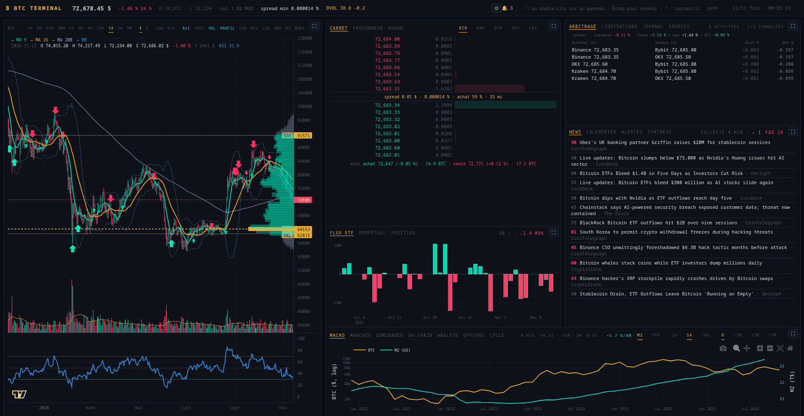
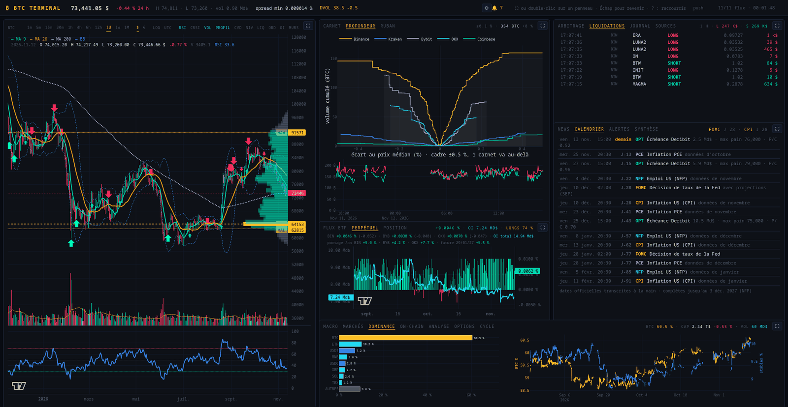
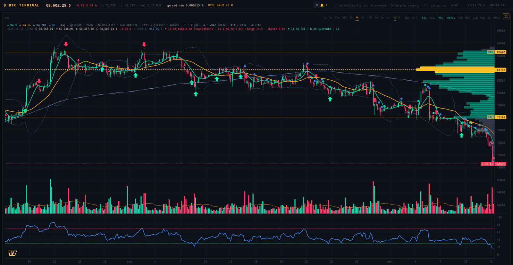
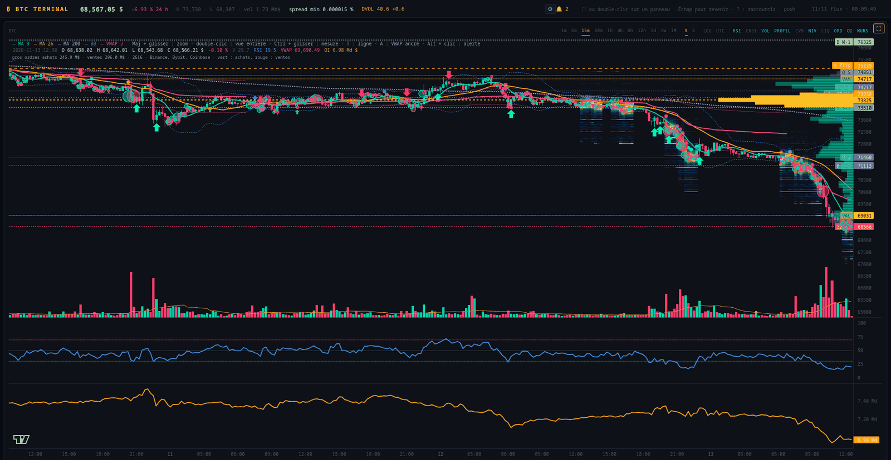
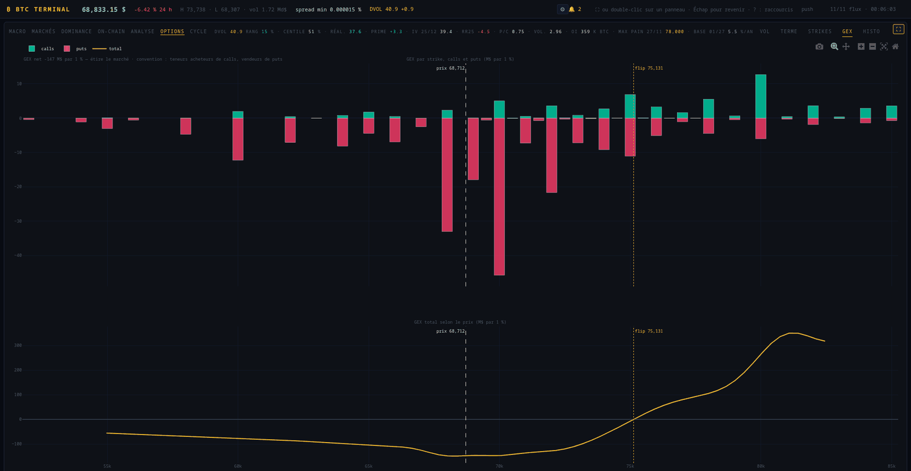
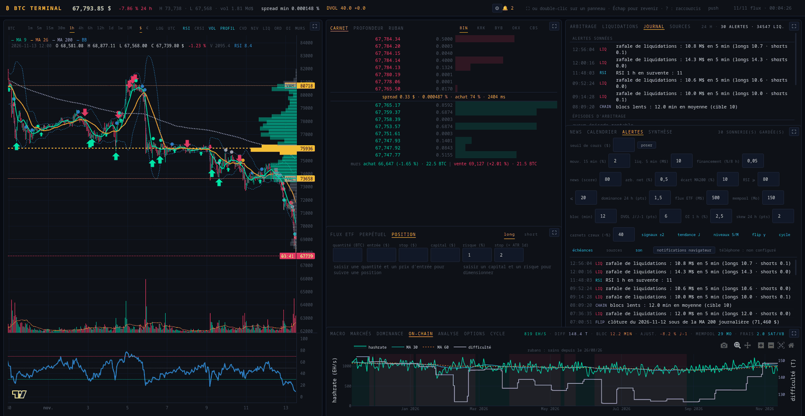
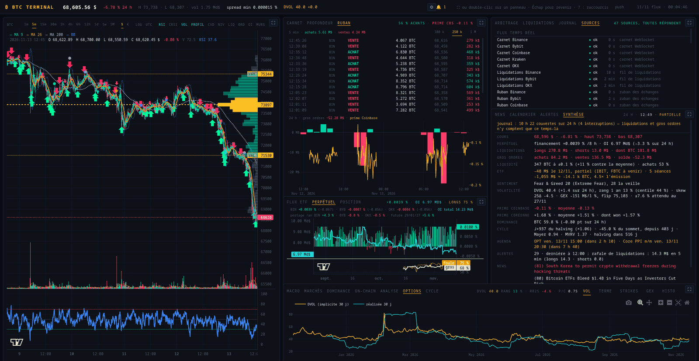

# 🪙 BTC Terminal

**Objectif du projet : construire une sorte de terminal Bloomberg orienté
Bitcoin** — un poste de travail unique regroupant, sur des panneaux
synchronisés, tout ce qu'il faut pour lire le marché : prix et indicateurs
techniques, carnets d'ordres et profondeur multi-exchange, opportunités
d'arbitrage, liquidations, flux des ETF spot, marché perpétuel, news à impact
et sentiment, calendrier macro, dominance, données on-chain et contexte
monétaire — le tout sous alertes configurables.

## Aperçu



*La grille par défaut — chandeliers Lightweight Charts avec moyennes, Bollinger
et profil de volume, carnet Binance en direct, écarts d'arbitrage entre cinq
plateformes, flux des ETF spot, fil de news scoré, cours contre masse
monétaire.*



*Les mêmes cellules, autres onglets — profondeur cumulée des cinq carnets,
liquidations Binance, Bybit et OKX, financement et open interest du
perpétuel comparés sur trois plateformes, calendrier macro, dominance.*



*Un panneau en plein écran d'un clic (ou d'un double-clic), Échap pour
revenir ; ici le prix en 4 h avec ses signaux gradués et le profil de volume
de la plage visible.*



*Les couches du graphique du prix : niveaux clés, gamma flip et VWAP ancré
(NIV), gros ordres en bulles (ORD), carte de chaleur du carnet sous les
chandeliers (MURS, qui se remplit depuis le démarrage du service), open
interest en volet (OI).*



*La vue GEX des options : ce que les teneurs de marché achètent ou vendent
par 1 % de mouvement, strike par strike, et le gamma flip où le régime
change.*



*Le journal relit la séance — alertes sonnées, épisodes d'arbitrage, bilan
des liquidations et des gros ordres —, la position se suit et se dimensionne,
les seuils d'alerte se règlent dans le terminal, et la chaîne (hashrate,
difficulté, mempool) a son onglet ; le prix en horaire.*



*La synthèse dit la journée en une page — cours, perpétuel, liquidations,
gros ordres, ETF, sentiment, volatilité, prime Coinbase, agenda, news —, et
ce que le journal en a vu : ici 7 h 22 sur 24, le portable ayant dormi. Le
ruban suit les gros ordres exécutés, SOURCES l'état de chaque flux, OPTIONS
la volatilité implicite de Deribit ; le prix en cinq minutes, une semaine de
bougies.*

Captures produites par `python tests/ui_captures.py docs/captures` sur le
terminal en marche, réduites à 1600 px et 256 couleurs.

**Démo à manipuler** — le panneau prix se dessine entièrement dans le
navigateur : il est servi en page statique, sur un instantané figé, à
**https://stefan-cambodia.github.io/btcterm/** — zoom (molette, ou un
cadre avec Maj + glisser), crosshair, pan vers le passé (l'historique se
charge en glissant), bascule $/€, échelle log, heure locale ou UTC,
panes RSI/CRSI, profil de
volume de la plage visible. Mille bougies par
intervalle, datées dans le bandeau ; rien n'y est en direct. La page se
regénère par `python -m terminal.demo docs` (voir « Outils
complémentaires »).

## Lancement

```bash
btcterm                   # ou : python -m terminal.app
```

→ **http://127.0.0.1:8050**

À distance, par tunnel SSH (le port n'est pas exposé sur le réseau) :

```bash
ssh -L 8050:localhost:8050 <machine>
```

En continu — un service utilisateur systemd qui sert le terminal par
gunicorn, journal et alertes couvrant alors la séance entière sans
navigateur ouvert : gabarit dans `terminal/systemd_service.conf`, fabrique
dans `terminal/wsgi.py` (`pip install -e '.[serve]'`). Sur un serveur qui
n'est pas à votre heure — souvent réglé en UTC —, donnez-lui la vôtre dans
l'unité (`Environment=TZ=Asia/Phnom_Penh`) : le graphique date à l'heure du
navigateur, mais le ruban, le journal, les alertes, le calendrier et l'heure
de la synthèse du matin suivent celle du serveur. Le bandeau affiche
« ⚠ heure serveur UTC » tant qu'elles diffèrent.

## Les panneaux

| Panneau | Contenu | Rafraîchissement |
|---|---|---|
| **Prix** | chandeliers de 1 m à 1 M, MA 9/26/200, Bollinger, POC + Value Area, niveaux clés (veille, semaine, mois), gros ordres en bulles, carte de chaleur du carnet, signaux, bascule `$`/`€`, échelle log, heure locale ou UTC, sous-graphiques optionnels dont le CVD et l'open interest, lecture au crosshair, alerte posée d'un Alt + clic, historique chargé au pan | bougie en temps réel (push), repli 2 s |
| **Carnet** | 8 niveaux de chaque côté, spread, part des acheteurs, murs des cinq plateformes, âge du flux, choix de la plateforme, devise du panneau prix | 100 ms (push), 250 ms en repli |
| **Ruban** | les gros ordres exécutés sur Binance, Coinbase et Bybit au comptant, avec le côté de celui qui a agressé ; part des achats agressifs sur 5 min au titre, seuil réglable 100 k$ / 250 k$ / 1 M$ ; dessous, le solde horaire des gros ordres et la prime Coinbase journalisés (onglet du carnet) | 2 s · 5 min |
| **Profondeur** | profondeur cumulée des 5 plateformes superposées, recentrées en % du prix médian et cadrées sur l'étendue médiane des carnets ; dessous, l'historique journalisé de la liquidité à ±0,1 % du prix (onglet du carnet) | 250 ms · 5 min |
| **Arbitrage** | écarts inter-plateformes nets des frais taker du premier palier (Kraken 0,80 %, Coinbase 0,60 %, les autres 0,10 %), triés par rentabilité ; sous le titre, les primes régionales — Coinbase, et la Corée (Upbit) décomposée en won et bitcoin | 250 ms, primes 2 s |
| **Liquidations** | positions fermées de force — Binance, toutes paires, OKX, tous ses perpétuels sur cryptomonnaies, et Bybit, dix grandes paires —, totaux de l'heure, fenêtre relue du journal au démarrage (onglet de l'arbitrage) | 250 ms |
| **Journal** | relecture des 24 h : alertes sonnées, épisodes d'arbitrage, bilan des liquidations (onglet de l'arbitrage) | 2 s |
| **Flux ETF** | entrées/sorties nettes des ETF spot ; en plein écran, cumul depuis le lancement, classement des émetteurs, fenêtre réglable (30 j / 90 j / 1 an / tout) et son net en bitcoins face à l'émission des mineurs (« ≈ -28.2 k BTC · 1.5× l'émission »). Un jour encore en cours de publication est dit « partiel », sa barre pâlie, les fonds attendus nommés au survol | 5 min |
| **Position** | la position tenue, saisie à la main : résultat, distance au stop, multiple du risque ; taille qu'autorise un risque choisi, stop à quelques ATR ; résultat au bandeau. Rien ne quitte le navigateur (onglet des flux ETF) | 2 s |
| **Perpétuel** | financement, open interest (prolongé par le journal) et part des comptes longs, sur canvas LWC ; dessous, le positionnement — la part des longs de la foule contre celle de l'argent des gros ; financement, prime et open interest comparés sur Binance, Bybit et OKX , et le portage annualisé — financement de chaque plateforme et base du future Deribit à trois mois, dans la même unité (onglet des flux ETF) | 5 min |
| **News** | fil scoré + indice Fear & Greed, dont la courbe sur 90 jours en plein écran | 2 s en lecture, collecte toutes les 15 min |
| **Synthèse** | les dernières 24 h en une page : cours et journée glissante, financement et open interest et leur écart, liquidations et gros ordres journalisés, flux ETF (et en bitcoins, face à l'émission), Fear & Greed, DVOL, skew et mouvement attendu, prime Coinbase, prime coréenne, dominance, cycle (halving, sommet, Mayer, MVRV), prochaines échéances macro, alertes sonnées, news les mieux notées ; la couverture du journal dite en tête quand la machine a dormi (onglet des news) | 5 min |
| **Calendrier** | prochaines échéances macro — FOMC, CPI, NFP, PCE — et grosses échéances d'options Deribit (montant, max pain, put/call), avec compte à rebours (onglet des news) | 5 min |
| **Alertes** | sonneries et réglages : seuils de cours, rafale de liquidations, financement extrême, news à fort score, écart d'arbitrage, écart à la MA 200, RSI extrême, signal gradué fort, clôture journalière de part et d'autre de la MA 200, franchissement du gamma flip des options, bascules du cycle (MVRV en zone extrême, capitulation des mineurs), échéance macro dans la demi-heure, glissement de dominance, jour de flux ETF, réseau chargé, bond de la volatilité implicite, déplacement du skew (onglet des news) | 2 s |
| **Macro** | cours contre masse monétaire M2 (US) ou contre l'offre de stablecoins (`STB`), décalage réglable et corrélations | 5 min |
| **Analyse** | tendance, écart à la MA 200, RSI, ATR et dernier signal de 15m à 1w ; au choix, bilan des signaux contre une référence, règles simples face à la détention, frais compris, carte des rendements mensuels, ou carte des heures — l'amplitude moyenne par jour et par heure sur un an, quand le bitcoin bouge ; export CSV (onglet de la macro) | 30 s |
| **Dominance** | parts de capitalisation et leur tendance journalisée — hors actifs que la source compte par intermittence —, cap totale et volume 24 h (onglet de la macro) | 5 min |
| **On-chain** | hashrate et difficulté sur un an, avec les « hash ribbons » — moyennes de 30 et 60 jours du hashrate, capitulations des mineurs ombrées, état en légende — ; rythme des blocs, prochain ajustement de difficulté estimé (« ajust. −7.6 % J-2 »), mempool, frais de transaction (onglet de la macro) | 5 min |
| **Marchés** | le bitcoin face au S&P 500, au Nasdaq, à l'or, au dollar et au taux à 10 ans : performance comparée en base 100 ou corrélation glissante sur 30 séances, tableau des cours, variations et corrélations à 30 et 90 séances (onglet de la macro) | 5 min |
| **Cycle** | où en est le bitcoin depuis le halving et depuis le sommet : compte à rebours du prochain halving, cycles superposés en multiple du cours du jour du halving, multiple de Mayer et son rang, repli depuis le plus haut, moyenne de 200 semaines, Pi cycle, le MVRV — capitalisation sur capitalisation réalisée, données Coin Metrics — avec le prix réalisé, le prix de revient du marché, et le multiple de Puell — l'émission du jour en dollars sur sa moyenne d'un an (onglet de la macro) | 5 min |
| **Sources** | l'état de chaque source — carnets, fils de liquidations, API REST, tâches de fond : ok, secours, panne, muet ou coupé, âge de la dernière donnée fraîche et dernière erreur ; ouvert aussi par l'avertissement « ⚠ N sources » du bandeau (onglet de l'arbitrage) | 10 s |
| **Options** | marché des options Deribit en cinq vues : DVOL contre volatilité réalisée ; volatilité par échéance avec ses ailes 25 delta, au-dessus de la base annualisée des futures ; open interest par strike d'une échéance, forward et max pain ; exposition gamma des teneurs de marché (GEX) par strike et son « gamma flip » ; historique du skew et de la volatilité, noté par le journal. Skew, put/call, open interest total au titre ; DVOL aussi au bandeau (onglet de la macro) | 1 min |

Les **liquidations** sont le pendant du perpétuel : quand une position à levier
ne couvre plus sa marge, la plateforme la ferme au marché, et ces fermetures
arrivent par rafales qui expliquent une partie des mèches du graphique. Le flux
est épisodique — plusieurs minutes de silence ne signalent aucune panne, et le
panneau distingue un flux coupé d'un marché calme.

Le **perpétuel** se lit avec le carnet : le taux de financement est le loyer que
les longs paient aux shorts toutes les huit heures, l'open interest mesure la
taille des positions ouvertes. Un financement élevé sur un open interest qui
gonfle décrit un marché endetté d'un seul côté — la configuration d'où sortent
les liquidations en cascade.

Sous le financement, un pane du **positionnement** compare deux parts des longs
publiées par Binance : celle de la **foule** — tous les comptes, chacun pour
un (orange) — et celle de l'**argent des gros** — les positions des 20 % de
comptes à la plus forte marge, pondérées par leur taille (blanc) —, autour de
50 %. Le 12 novembre 2026, 75 % de la foule était à la hausse, mais 70 % de
l'argent des gros seulement ; comptés par tête, les gros étaient 77 %. Quand
la foule charge un côté que les gros allègent, c'est d'ordinaire elle qui
paie. Binance ne sert que trente jours ; le relevé de marché note les deux
parts toutes les cinq minutes et le graphique se prolonge par le journal,
comme l'open interest. En plein écran, le titre ajoute la part des gros.

**Onglets** — une cellule peut héberger plusieurs panneaux, choisis par les
onglets posés à la place du titre. Par défaut, cinq cellules en portent :
carnet et profondeur, flux ETF et perpétuel, news avec calendrier et
alertes, macro et dominance et on-chain — plus l'arbitrage, qui partage sa
place avec les liquidations et le journal. Un panneau caché n'est pas dans la page — il ne coûte rien, et il
se remplit dès qu'on l'affiche.

**Push** — les panneaux à 250 ms ont deux canaux : quand le navigateur tient
un WebSocket ouvert sur `/push`, le serveur pousse le rendu à 100 ms, carnet
compris, et la profondeur à la seconde, et l'horloge est coupée. Sans
WebSocket — ou dès que la connexion tombe — l'interrogation reprend, sans rien
casser. Le bandeau affiche le canal en vigueur (« push » ou « poll »). C'est ce
qui garde le carnet vif sur un tunnel SSH lointain, où chaque aller-retour HTTP
paie la latence. Le carnet part d'ailleurs en données que la page écrit en
place, sans passer par Dash : 0,9 Ko par trame au lieu de 11.

**Disposition** — le **⚙** du bandeau ouvre un dialogue où chaque panneau se
range dans la cellule de son choix : un sélecteur par panneau, donc aucun moyen
d'en perdre un ni de l'afficher deux fois ; seule une cellule vidée de tout est
refusée. Plusieurs panneaux rangés ensemble se partagent la cellule par
onglets. « Par défaut » remplit le formulaire du rangement d'origine —
« Appliquer » reste le seul geste qui écrit. La disposition survit au
rechargement, comme le reste des réglages.

**Plein écran** — trois façons d'agrandir un panneau :

- le **⛶** en haut à droite du panneau,
- un **double-clic** n'importe où dessus (sauf sur un graphique, qui garde
  le double-clic pour réinitialiser ses axes),
- puis `Échap` ou un second clic pour revenir à la grille.

Cliquer le ⛶ d'un autre panneau bascule directement de l'un à l'autre.

Les panneaux s'adaptent à la place disponible :

- le **cours** domine le graphique : les oscillateurs cochés vivent dans
  leurs propres panes, en bas, et tout ce qu'on décoche rend sa hauteur au
  cours — jusqu'à **100 %** si l'on décoche tout ;
- le **carnet** affiche 8 niveaux de chaque côté dans la grille, 20 en plein
  écran.

**Intervalles** — `15m` `30m` `1h` `4h` `6h` `12h` `1d` `1w` `1M`, à la casse
Binance : `m` pour les minutes, `M` pour le mois. Chacun a sa profondeur
d'historique — de quoi nourrir la MA 200 en intraday, sans tirer trente ans de
bougies mensuelles. La case `LOG` passe l'axe des prix en
logarithmique — indispensable dès qu'on remonte plusieurs années, où une
progression de 4 000 à 80 000 dollars écrase tout le début du graphique.

**Heure** — le graphique du prix et celui du perpétuel sont à l'heure locale
du navigateur, comme le reste du terminal ; la case `UTC`, à côté de `LOG`,
les passe en UTC, et la lecture de la bougie le précise. Les bougies d'un jour
et plus restent le jour UTC de Binance, qui ouvre à minuit UTC — 7 h à Phnom
Penh. L'étiquette du dernier prix porte le **temps qui reste avant la clôture
de la bougie** (`13:33` en 15m, `1:16:03` en 4h, `3j 12h` en semaine), à la
seconde — la semaine de Binance se clôt le lundi 0 h UTC, le mois au 1er ;
rien sur la série de démonstration, dont les bougies ne clôturent jamais.

**Sous-graphiques optionnels** — les cases `RSI` · `CRSI` · `VOL` · `PROFIL` de
la barre de titre du panneau prix décident de ce qui accompagne les chandeliers.
Tout ce qu'on décoche rend sa hauteur au cours. Par défaut : RSI, volume et
profil de volume ; le CRSI est disponible mais masqué.

**Carte des liquidations** — la case `LIQ` (touche `M`, commande `/carte` ;
`/liq` ouvre toujours l'onglet) pose à gauche du graphique le notionnel liquidé
par tranche de prix sur la plage visible, lu dans le journal : rouge pour les
longs fermés de force, vert pour les shorts. La légende dit le total et les
plateformes présentes — Binance, Bybit et OKX —, et rien pendant le sommeil de
la machine : la carte prendra tout son sens sur un serveur allumé en
permanence.

**Open interest** — la case `OI` (commande `/oi`) ouvre sous le cours un
volet de l'open interest du perpétuel Binance, en dollars, au pas le plus
proche de l'intervalle (cinq minutes pour la minute, le jour pour la semaine et
le mois), prolongé au-delà des trente jours de Binance par le journal. Ce que
le cours seul ne dit pas : une hausse portée par des positions neuves ou par
des shorts qui rachètent, une baisse qui purge le levier ou qui en ajoute.

**Murs** — la case `MURS` (commande `/murs`) peint sous les chandeliers la
carte de chaleur des carnets dans le temps : toutes les dix secondes, les cinq
carnets additionnés par tranche de 25 $ sur ±2 % autour du cours, du bleu sombre
(peu de liquidité) au jaune et au blanc (les murs). Les murs qui tiennent
tracent des bandes ; ceux qui disparaissent avant d'être touchés s'arrêtent
net. Elle commence avec le service et garde trois jours.

**Gros ordres** — la case `ORD` (touche `O`, commande `/ord`) pose sur les
chandeliers les ordres de 100 k$ et plus que le ruban a journalisés : une
bulle par bougie et par côté, à leur prix moyen pondéré, d'une surface
proportionnelle au montant — vert pour les achats au marché, à gauche de la
bougie, rouge pour les ventes, à droite. On y voit où les gros ont
réellement traité, et dans quel sens ; la légende dit les totaux et les
plateformes (Binance, Coinbase, Bybit). Trente jours de journal.

**Niveaux clés** — la case `NIV` (touche `N`) trace les repères que les traders
regardent : plus haut et plus bas de la veille (`H J-1`, `B J-1`), de la semaine
passée (`S-1`) et du mois passé (`M-1`), et l'ouverture du jour, de la semaine
et du mois en cours (`O J`, `O S`, `O M`, pointillées) — en UTC, comme les
bougies de Binance, la semaine partant du lundi. Gris de plus en plus clairs du
jour au mois, ils ne se confondent pas avec les moyennes ; deux niveaux au même
prix n'en font qu'un (`B S-1/M-1`). Ce sont des repères où les ordres
s'accumulent d'ordinaire, pas des garanties de rebond ; aucun n'est tracé sur
la série de démonstration. S'y ajoutent, en ambre, les niveaux que posent les
options : le **gamma flip** (`γ flip`, voir le panneau OPTIONS), le **max
pain** de l'échéance par défaut (`max pain 27/11`) et les deux bornes du
**mouvement attendu** d'ici là (`+1σ 27/11`, `−1σ 27/11`, en pointillé
espacé) : la fourchette à un écart-type que le prix des options suppose —
forward × volatilité à la monnaie × √(temps restant), ±7,7 % le 12 novembre
2026, de 66 000 à 77 100 $. Le cours a, selon les options, environ deux
chances sur trois d'y finir ; une lecture du risque payé, pas une prévision.
La même case trace le
**VWAP ancré** (en rose) et ses
bandes à un écart-type (pointillées) : le prix moyen pondéré par le volume
depuis le début de la journée UTC jusqu'en 1h, de la semaine en 4h à 12h, du
mois en journalier — la légende dit l'ancrage (`VWAP J`, `S`, `M`), la lecture
du crosshair sa valeur. Au-dessus, les acheteurs de la période sont en gain ;
en dessous, en perte.

**VWAP ancré à la main** — la touche `A` (commande `/ancre`) arme l'ancrage,
et un clic sur une bougie y pose une ancre : de là jusqu'à la dernière bougie,
le prix moyen pondéré par le volume de tous ceux qui ont traité depuis — depuis
le sommet, depuis le dernier creux, depuis le jour d'une annonce. Au-dessus,
ils sont en gain ; le cours y revient souvent chercher appui ou résistance. La
courbe est blanche, nommée sur l'axe des prix par sa date (`AV 11/10 15:00`),
et la lecture du crosshair donne sa valeur. Trois ancres au plus — la
quatrième remplace la plus ancienne —, gardées dans le navigateur en heures
absolues : elles survivent à la devise, à l'intervalle et au rechargement.
Lue dans un intervalle plus large, une ancre part du début de la bougie qui
la contient ; dans un plus fin, si elle précède l'historique chargé, la
légende le dit, et remonter le graphique la fait réapparaître. `Alt` + clic
sur la courbe la retire, `/effacer` les retire toutes avec les lignes. La
démo statique la calcule aussi : tout se fait dans le navigateur.

Le graphique conserve zoom et pan pendant que les données coulent — c'est ce qui
permet d'analyser une zone sans être recadré à chaque tour d'horloge. Les
réglages, eux, survivent au rechargement de la page : intervalle, devise,
échelle, sous-graphiques, plateforme du carnet, fenêtre et décalage macro,
l'onglet actif de chaque cellule et la disposition de la grille sont conservés
dans le navigateur (localStorage). Seul le plein écran ne revient pas :
recharger rend la grille.

**Rendu du prix** — le panneau prix dessine sur canvas dans le navigateur,
en [Lightweight Charts](https://tradingview.github.io/lightweight-charts/)
(vendoré, aucun CDN) : crosshair aimanté, ligne du dernier prix, bougie
courante mise à jour en temps réel par le canal push, historique antérieur
chargé à la volée quand on remonte le graphique, profil de volume recalculé
sur la plage visible. Au-delà de la molette, **Maj + glisser** trace un
cadre sur le cours et y ajuste temps et prix — l'axe des prix cesse alors
de s'auto-ajuster — ; un **double-clic** rend la vue entière. Le serveur ne sert que des données (`/api/klines`,
`/api/profile`) et reste la seule source de vérité des indicateurs. Le
panneau perpétuel dessine de la même façon (`/api/perp`) — financement en
histogramme signé, open interest en ligne — ; les autres panneaux sont des
figures Plotly.

**Hors ligne** — si Binance est injoignable au démarrage, le panneau prix sert
une série de démonstration générée localement plutôt qu'un cadre vide, et le
signale par un bandeau orange : les chiffres affichés ne sont alors pas réels.
Les séries lentes — flux ETF, M2, stablecoins, MVRV, séries de chaîne, DVOL,
marchés traditionnels, Fear & Greed — survivent au redémarrage : leur dernière
lecture est gardée dans `~/.btcterm/cache` (trente jours au plus), et un
service relancé pendant la panne d'une de ces sources la sert de secours —
le panneau SOURCES le dit — au lieu d'un panneau vide.

**Depuis un pays qui bloque les exchanges** — certains fournisseurs d'accès
(au Cambodge, par exemple) ne refusent pas `api.binance.com`, `stream.bybit.com`
ou `ws.okx.com` : leur résolveur DNS y répond `127.0.0.1`, et le terminal
tombe sur la démo sans qu'aucune erreur ne le dise. Le hub pose au démarrage
une résolution de secours (`btcterm/resolver.py`) : les noms des cinq
plateformes, et tout nom public qui résout en adresse de bouclage ou en une
adresse connue pour ne pas répondre (`SINKHOLES`), sont demandés à un résolveur
DNS sur HTTPS joint par son adresse IP (1.1.1.1, puis 8.8.8.8) — et les
connexions partent vers les vraies adresses. Rien à configurer ; un
avertissement `résolution du système écartée pour …` dans le journal signale
chaque nom sur lequel le système et DoH se contredisent.

Le remède de fond est de faire de même pour tout le système, ce qui vaut
aussi pour le navigateur et les outils en ligne de commande. Avec
systemd-resolved, un fichier suffit :

```ini
# /etc/systemd/resolved.conf.d/dns-over-tls.conf
[Resolve]
DNS=1.1.1.1#cloudflare-dns.com 1.0.0.1#cloudflare-dns.com 9.9.9.9#dns.quad9.net
FallbackDNS=8.8.8.8#dns.google
DNSOverTLS=yes
Domains=~.
```

puis `sudo systemctl restart systemd-resolved` ; `resolvectl query
api.binance.com` doit alors rendre une adresse publique. Le DNS sur TLS
empêche le fournisseur d'intercepter les requêtes vers ces résolveurs.

Le fil des liquidations écoute **trois plateformes** — Binance
(`!forceOrder@arr`, toutes ses paires), Bybit (canal `allLiquidation`, dix
grandes paires) et OKX (tous ses perpétuels) — qui nourrissent le même
panneau ; chaque ligne dit la sienne (`BIN`/`BYB`/`OKX`), et le badge nomme le
lien qui manque, comme celui qui tient sans rien livrer depuis plus d'un quart
d'heure (« Binance muet depuis 22 min »). Ce silence-là a longtemps été mis
sur le compte du pays : c'était l'adresse. Depuis la scission de ses flux
futures (annoncée en mars 2026), Binance ne livre les liquidations qu'à la
route `/market` (`wss://fstream.binance.com/market/ws/…`) ; à l'ancienne
adresse sans route, la connexion s'ouvre, l'abonnement est acquitté, et rien
n'arrive. Corrigé le 12 novembre 2026 ; un test refuse désormais toute adresse
de ces flux sans sa route.

**News** — le terminal **remplit** lui-même `~/.btc_news/news.db`, toutes les
quinze minutes, avec les règles de scoring du tracker : plus besoin du timer
systemd pour avoir un fil vivant. La barre de titre du panneau donne l'âge de la
dernière collecte, et le nombre d'articles qu'elle a rapportés.

```bash
python -m terminal.app --no-news                 # laisser la base au tracker
CRYPTOPANIC_API_KEY=… python -m terminal.app     # ajouter CryptoPanic aux RSS
```

**Journal** — les données qui mouraient avec le processus sont désormais
journalisées dans `~/.btcterm/journal.db` (30 jours de rétention, purgée toutes
les six heures, de l'ordre de 150 Mo une fois plein, les trois plateformes
livrant) : chaque
liquidation, et chaque épisode d'arbitrage rentable — ouvert quand une paire
devient rentable, clos quand elle a cessé de l'être, une ligne par épisode
avec le meilleur profit observé. S'y ajoutent, toutes les cinq minutes, les
**instantanés de marché** (dominance, capitalisation, open interest,
financement) que leurs API refusent de servir en série ; leur rétention est de 400 jours, et
leur accumulation donne au panneau dominance sa tendance et au perpétuel un
financement et un open interest qui remontent au-delà des trente jours de
Binance. La séance se
relit après coup — dans le terminal même (panneau JOURNAL, onglet de
l'arbitrage) ou à la ligne de commande :

```bash
python -m btcterm.journal --heures 6             # relire la séance : couverture, liquidations, gros ordres, alertes
python -m terminal.app --no-journal              # s'en passer
```

**Alertes** — le terminal sait attirer l'attention quand on ne le regarde
pas : seuils de cours posés depuis le panneau ALERTES (le sens — au-dessus,
au-dessous — est figé à la pose, avec hystérésis de réarmement), rafale de
liquidations, financement extrême, news à fort score, écart d'arbitrage —
plus trois règles relatives lues sur la bougie horaire close : écart du
cours à sa MA 200, RSI hors bornes, signal gradué fort (±2), muettes sur la
série de démonstration hors ligne — une neuvième assise sur l'historique
journalisé : le glissement de la dominance BTC sur 24 h, qui ne peut sonner
qu'une fois l'historique accumulé — et deux lues sur les panneaux ETF et
on-chain : un jour de flux ETF au-delà du seuil (une sonnerie par jour,
le jour présent au démarrage tenu pour vu) et un réseau chargé, mempool
gonflé ou blocs lents — et une sur le marché des options : DVOL qui monte de
plus de six points (réglable) au-dessus de sa clôture de la veille, ce qui
n'est arrivé que dix jours sur l'année écoulée — et une sur ce que le journal
garde de ce marché : le skew 25 delta qui se déplace de plus de deux points
en 24 h (réglable, seuil encore provisoire), le message disant si ce sont les
puts ou les calls qui se renchérissent — et une sur la liquidité journalisée
des carnets : le volume offert à ±0,1 % du prix tombé à 40 % sous sa moyenne
de 24 h (réglable, seuil provisoire lui aussi), muette tant que la journée
ne compte pas six heures de relevés — et une sur le terminal lui-même : un
lien temps réel coupé ou une source en panne depuis plus d'un quart d'heure,
puis son rétablissement (case « sources », décochée par défaut ; `curl localhost:8050/api/health`
dit le même état à un outil de surveillance).
Les règles sonnent sur le front montant, sous délai de garde — une condition
qui dure ou qui clignote ne sonne pas en rafale. La cloche du bandeau compte
la dernière heure et ouvre le panneau d'un clic, où qu'il soit rangé ; le bip et les notifications navigateur (permission
demandée d'un clic) retentissent même panneau replié ; chaque sonnerie part
au journal et se relit avec la séance. Les seuils survivent au rechargement
et réarment le moteur au chargement de la page.

**Sur le téléphone** — un terminal qui tourne sur un serveur sonne pour
personne : chaque alerte peut aussi partir vers [ntfy](https://ntfy.sh), qui
la livre en notification push à l'application Android ou iOS abonnée au même
sujet. Rien ne part tant que le sujet n'est pas posé :

```bash
export BTCTERM_NTFY=https://ntfy.sh/un-sujet-long-et-imprevisible
python -m btcterm.notify "bonjour"     # essai
btcterm                                # ou Environment= dans l'unité systemd
```

Sur ntfy.sh, le sujet fait office de mot de passe : un nom long et
imprévisible. Un serveur ntfy auto-hébergé convient aussi
(`BTCTERM_NTFY_TOKEN` s'il est protégé). Le panneau ALERTES dit si le
téléphone est servi.

**La synthèse du matin** — le panneau SYNTHÈSE part aussi vers le même
sujet, une fois par jour, à l'heure locale posée — celle du serveur, voir
plus haut pour un serveur distant ; une machine qui dormait à
l'heure dite l'envoie au réveil, et un service relancé ne la renvoie pas :

```bash
export BTCTERM_BRIEF=07:00             # ou btcterm --brief 07:00
python -m btcterm.brief                # l'aperçu, à la ligne de commande
```

**Macro** — le panneau du bas confronte le cours à la masse monétaire M2 des
États-Unis (série H.6 de la Fed, mensuelle). Le sélecteur `+1M` … `+3M` décale
M2 vers l'avant pour éprouver l'idée d'un cours qui suivrait la liquidité avec
un trimestre de retard ; les deux corrélations affichées disent ce qu'il en est.
Celle des **niveaux** est toujours forte et n'apprend rien — deux séries qui
montent depuis dix ans vont ensemble ; celle des **variations sur trois mois**
est la seule qui informe.

**Ruban** — le carnet montre des intentions, le ruban ce qui s'exécute : chaque
gros échange de Binance, Coinbase et Bybit au comptant, et surtout qui l'a
voulu — un achat au prix vendeur est un acheteur pressé. Le titre donne la
part des achats agressifs sur cinq minutes (toutes tailles, détail par place
au survol) et la **prime Coinbase** — l'écart du bitcoin en dollars sur
Coinbase, la place des acheteurs américains, à Binance en USDT : positive,
l'Amérique paie plus cher —, la ligne dessous les montants et le seuil. Les gros
ordres vont au journal : le ruban survit à un redémarrage, et le panneau
JOURNAL fait le bilan de la journée (achats, ventes, solde). Le sens du preneur ne
se lit pas pareil d'une place à l'autre : il a été mesuré contre le carnet
plutôt que supposé, et Coinbase, qui marque le côté du teneur, se lit à
l'envers des deux autres.

**Sources** — le terminal lit une vingtaine de sources, et quand l'une tombe,
le bandeau en dit le nombre ; il compte aussi les liens temps réel qui tiennent
(« 10/10 flux » : carnets, liquidations, ruban), nomme les absents au survol, et
l'un comme l'autre ouvrent ce panneau d'un clic. Le panneau SOURCES — ouvert d'un clic sur cet
avertissement — en donne le détail sans passer par `journalctl` : pour chaque
carnet, fil de liquidations, API, source de news et tâche de fond, son état (ok, secours,
panne, muet, coupé, inactif — écrit en toutes lettres, pas seulement en
couleur), l'âge de sa dernière donnée fraîche et sa dernière erreur en une
ligne. Les pannes viennent en tête.

**Marchés** — le bitcoin bouge-t-il seul, ou avec le reste ? Le panneau le
confronte au S&P 500, au Nasdaq 100, à l'or, au dollar (DXY) et au taux
américain à dix ans, sur les séances de ces marchés — ses week-ends n'y
comptent pas. **PERF** ramène chaque série à 100 au début de la fenêtre (1 mois
à 1 an) ; **CORR** trace la corrélation des variations quotidiennes sur trente
séances, de −1 à 1 — au-dessus de zéro, le bitcoin bouge avec ce marché. Le
tableau donne cours, variation du jour et du mois — en points de base pour le
taux — et corrélations à 30 et 90 séances : celle à 30 suit le régime, celle à
90 le confirme. Le graphique ne porte que trois marchés, le Nasdaq et le taux
restant au tableau : au-delà, les courbes ne se distinguent plus. Source :
l'API de graphiques de Yahoo Finance, non documentée et sans clé.

**Cycle** — le bitcoin a une horloge que les autres marchés n'ont pas : tous
les 210 000 blocs, quatre ans à peu près, son émission est divisée par deux.
Le panneau situe le cours dans ce cycle, sans rien prédire. **CYCLES**
superpose les cycles de 2016, 2020 et 2024 en multiple du cours du jour de leur
halving, jour pour jour, sur une échelle logarithmique. **MAYER** trace le
cours rapporté à sa moyenne de 200 jours, entre ses bornes d'usage — sous 0,8
il en est loin, au-dessus de 2,4 il s'en est détaché comme aux sommets.
**REPLI** trace la distance au plus haut : profondeur et durée des marchés
baissiers s'y lisent d'un coup. **MVRV** trace la capitalisation sur la
capitalisation réalisée, entre 1 (les creux) et 3,5 (les sommets passés).
**PUELL** trace le multiple de Puell, sur une échelle logarithmique : la
valeur des bitcoins émis dans la journée sur sa moyenne d'un an, ce que
gagnent les mineurs rapporté à ce qu'ils gagnent d'habitude — sous 0,5, leur
paie est tombée à moins de la moitié de l'ordinaire (2015, 2018, 2022) ;
au-dessus de 4, elle a quadruplé (2013, 2017). Les bornes sont une convention, et les sommets de 2021 et 2024 sont
restés loin sous la borne haute. L'année qui suit chaque halving est ombrée :
la moyenne y compte encore des jours à subvention double, et le multiple
sort bas sans que les mineurs souffrent. Ces deux vues lisent Coin Metrics
(CC BY-NC, nommé à l'écran). Le tableau donne la date estimée du prochain
halving (à dix minutes le bloc) et les blocs restants, le jour du cycle et ce
que valaient les précédents au même jour, le sommet et le repli, le multiple de
Mayer avec la part des jours passés où il était plus bas, la moyenne de 200
semaines, le rapport du Pi cycle, le MVRV et le prix réalisé, le multiple
de Puell et son rang. Le cours vient de l'historique journalier du
disque, qui commence en août 2017 — le cycle de 2016 n'y entre qu'à son
quatre-centième jour —, et de la hauteur de la chaîne chez blockchain.info ;
sans elle, la date est estimée et porte un tilde. Le panneau reste en dollars.

**Primes régionales** — sous le titre de l'ARBITRAGE, les écarts qu'aucun
arbitrage ne ferme vite. La prime **Coinbase** (le bitcoin en dollars à
Coinbase contre Binance en USDT) lit la demande américaine. La prime
**coréenne** — la « prime kimchi » — lit celle des particuliers coréens, qui
achètent en wons sur Upbit derrière un contrôle des changes : 21,6 % au
plus haut le 19 mai 2021, 10,3 % le 6 mars 2024. Elle se décompose
exactement en deux facteurs, `Corée = won + BTC` (composés, pas additionnés) :
le **won**, l'USDT d'Upbit contre le dollar, est le prix de la sortie du won
vers la cryptomonnaie, structurel, autour de 1,4 % ; le **BTC**, le bitcoin
contre l'USDT d'Upbit face au cours mondial, est la demande propre au
bitcoin. Le 12 novembre 2026, la prime de 1,4 % était tout entière celle du
won : aucun appétit coréen pour le bitcoin. Au-delà de 3 %, elle passe en
orange. Le won est le cours en séance de Yahoo, la référence de la BCE en
secours ; la synthèse en donne la moyenne sur 24 h, et le relevé de marché
la journalise toutes les cinq minutes.

**Options** — le carnet, le perpétuel et les liquidations disent ce que le
marché fait ; les options disent ce qu'il craint et ce qu'il paie pour s'en
couvrir. Le panneau lit Deribit, sans clé, et propose trois vues. **VOL**
confronte DVOL, la volatilité implicite à trente jours — le VIX du bitcoin —, à
la volatilité réalisée sur le même horizon : l'écart est la prime des options,
qui se retourne quand le marché bouge plus qu'il ne l'attendait. **TERME** trace
la volatilité à la monnaie de chaque échéance et ses deux ailes à 25 delta —
l'aile des puts au-dessus de celle des calls, c'est la couverture à la baisse
qui se paie —, au-dessus de la base annualisée des futures à échéance, le
pendant à terme du financement du perpétuel. **STRIKES** montre l'open interest
d'une échéance par strike, calls contre puts, avec le forward et le max pain :
le prix où les acheteurs d'options perdraient le plus à l'échéance, une
lecture du positionnement et non une prévision ; une bande claire y marque le
mouvement attendu d'ici l'échéance (±1σ). **GEX** estime l'exposition gamma
des teneurs de marché, par strike, en millions de dollars par 1 % de
mouvement : ce qu'ils doivent acheter ou vendre pour rester couverts quand le
prix bouge. Positive, ils vendent la hausse et achètent la baisse — le marché se
tasse ; négative, ils suivent le mouvement — il s'étire. Le « gamma flip » est le
prix où le total change de signe ; en plein écran, la part des calls et des
puts, et le GEX total selon le prix. La convention de signe — teneurs acheteurs
des calls, vendeurs des puts — est une hypothèse usuelle, écrite sur le
graphique : la chaîne ne dit pas qui tient quoi. Le flip et le GEX net figurent
aussi à la synthèse, ligne volatilité, et le flip parmi les niveaux clés du
graphique du prix. **HISTO** relit ce que seul le
journal garde : Deribit ne sert gratuitement l'historique que de DVOL, et le
terminal note toutes les cinq minutes la volatilité à un mois, le skew, le
put/call et la base depuis le 6 novembre 2026 — la vue se remplit à l'usage. Le titre donne le skew 25 delta
à un mois, le ratio put/call et, en plein écran, la prime, l'open interest
total et la base à trois mois. Les deltas sont calculés en Black-76 depuis la
volatilité de marque de Deribit (`btcterm/options.py`) ; les strikes restent en
dollars, la devise des contrats. DVOL est aussi au bandeau, avec sa variation
depuis la veille, et le clic l'y ouvre le panneau.

**Calendrier** — les prochaines échéances qui font bouger le marché : décisions
du FOMC (avec ou sans projections), inflation CPI et PCE, rapport sur l'emploi
(NFP), et les échéances d'options Deribit qui pèsent au moins 5 % de l'open
interest (`OPT`, en vert : l'hebdomadaire du vendredi, la mensuelle, les
trimestrielles), à 8 h UTC, avec leur montant, leur max pain et leur put/call —
lues dans la chaîne, pas tenues à la main ; chacune avec son compte à rebours, son jour et son heure dans le fuseau de la machine. Aucune API
publique satisfaisante n'existe pour ces dates ; elles sont transcrites à la
main dans `btcterm/macrocal.py` depuis les calendriers officiels — la Fed, le
BLS et le BEA publient leurs dates un à deux ans à l'avance ; la liste court
jusqu'en décembre 2027. Le pied du panneau dit jusqu'où elle est complète,
famille par famille, et nomme celle qui s'épuise dans le mois — un calendrier
qui se tait parce qu'il est périmé doit se voir.

## Architecture

- **`btcterm/`** — le socle : indicateurs, carnets et connecteurs WebSocket,
  moteur d'arbitrage, collecteurs REST, base de news partagée avec le tracker,
  et le hub qui n'ouvre qu'une connexion par plateforme pour tous les panneaux.
- **`terminal/`** — l'application Dash : grille, thème, figures, panneaux,
  rendus Lightweight Charts du prix et du perpétuel (`lwc.py`,
  `assets/lwc-price.js`, `assets/lwc-perp.js`, et `assets/lwc-clock.js` qui
  leur donne l'heure locale).

Détail complet dans [`ARCHITECTURE.md`](ARCHITECTURE.md), feuille de route en
[§7](ARCHITECTURE.md#7-feuille-de-route-vers-le-terminal).

**Où en est le projet** — le terminal couvre le prix et ses indicateurs, le
carnet, la profondeur comparée, l'arbitrage, les liquidations, les flux ETF, le
marché à terme, les news, le calendrier macro, la dominance, la chaîne et le
contexte macro : la couverture visée par la feuille de route est atteinte. Les
scripts qu'il remplace ont été supprimés — la TUI d'arbitrage, doublon du
panneau du même nom, en dernier — et ceux qui restent (export ETF, tracker
de news) ne font double emploi avec aucun panneau. Les dernières retouches
viennent de l'usage plutôt que de la feuille de route : la cloche du bandeau
ouvre le panneau alertes d'un clic, la fenêtre des liquidations est relue
du journal au démarrage, un panneau vide après un redémarrage se lisant comme
une panne du flux, le badge des liquidations nomme le lien qui tient sans
rien livrer, Bybit portant seul le panneau là où Binance se tait, et le
service s'arrête en une seconde au lieu d'expirer sous SIGKILL — gunicorn
attendait la fin des WebSockets, qui n'en ont pas. Le journal de séance a
aussi révélé des « arbitrages » de plusieurs heures à prix figé : un niveau
fantôme dans un carnet nourri par deltas. Les carnets se resynchronisent
désormais quand ils se croisent, et le moteur les écarte en attendant. Et
la machine qui dort n'est plus passée sous silence : le panneau journal
compte les interruptions de séance, et les courbes journalisées s'y
rompent au lieu de tirer un trait par-dessus. Enfin, les alertes de la
journée sont relues au démarrage comme les liquidations : un service
relancé n'affiche plus « aucune alerte » après une nuit qui a sonné. Et
une source REST qui tombe se lit dans `journalctl` — première panne,
rétablissement, durée, et la cause en clair plutôt qu'une URL tronquée —
au lieu de laisser des trous muets dans l'historique : l'instantané
journalisé n'écrit que des valeurs fraîches.

La séance suivante a tiré les conséquences du bilan des signaux, qui disait
les flèches du graphique sans valeur : le panneau ANALYSE compare désormais
quelques règles simples à la détention, frais compris — la MA 200 journalière
fait à peu près le rendement de la détention, investie la moitié du temps et
avec un repli moindre —, et c'est sur son franchissement qu'une alerte sonne
maintenant. Le terminal a aussi gagné un seizième panneau, POSITION, qui suit
une position saisie à la main et dimensionne d'après le risque et l'ATR, sans
parler à aucun compte ; une ligne de commande (`/`), la mesure d'un mouvement,
les lignes de tendance et la capture du graphique ; les murs du carnet, toutes
plateformes réunies ; le perpétuel comparé sur Binance, Bybit et OKX ; la carte
des rendements mensuels ; et une sonnerie trente minutes avant chaque échéance
macro. Le carnet, enfin, n'est plus rendu par Dash : la page écrit en place des
données préformatées, et il repart dix fois par seconde, plein écran compris,
là où il faisait geler la page jusqu'à neuf secondes à deux fois par seconde.
Et un pan vers le passé qui tombe pendant une pause de Binance ne ferme plus
l'historique pour la séance : la page manquée se dit, et le graphique la
redemande. Un retour d'onglet ne fait plus sauter la vue de deux ans quand
on a remonté le passé, et une page égarée au changement d'intervalle ne se
colle plus au milieu de la série. Le terminal a enfin gagné un dix-septième
panneau, OPTIONS — volatilité implicite contre réalisée, courbe des échéances
et skew, open interest par strike et max pain, base des futures à échéance —,
DVOL au bandeau et une alerte quand la volatilité implicite bondit ; puis un
dix-huitième, MARCHÉS, qui dit si le bitcoin bouge avec les actions, l'or ou
le dollar. Depuis, le terminal en compte vingt et un avec le RUBAN des gros
ordres et le CYCLE, qui situe le cours depuis le halving et depuis le sommet,
et les alertes partent jusqu'au téléphone par ntfy.
Ce même journal a ensuite compté cinquante-quatre resynchronisations
Kraken en une matinée, et nommé la cause qu'on croyait fortuite : le flux
décrit une fenêtre de vingt-cinq niveaux, le carnet en gardait cent, et
ce que Kraken cesse de suivre devient fantôme — le carnet est désormais
borné à sa fenêtre. Et un onglet chargé avant un redémarrage — souvent
pendant que la machine dormait — se recharge de lui-même au lieu de
parler au nouveau serveur avec l'ancien graphe de callbacks : la page
emporte le jeton de son serveur et le compare à `/api/boot` avant chaque
connexion. Enfin, la boucle d'observation attend le réseau au démarrage —
l'unité utilisateur part avant que la machine ne soit connectée — au lieu
de déclarer cinq sources en panne deux secondes après le boot — et le
réveil de la machine, qui rejouait la même salve sept fois par jour,
est traité comme un boot. Il se lit désormais sur les horloges du noyau,
qui voient aussi les sommeils de quelques secondes ; dans la minute qui le
suit, un échec n'est plus une panne — il comptait le sommeil dans la durée
de la panne d'avant et retenait le graphique une minute après le retour du
réseau. Un accroc de Binance, de même, ne fige plus le graphique une minute
ni n'écrit une ligne de panne par intervalle : la source est retentée après
cinq secondes, puis d'autant plus tard que la panne dure. Le tableau des
liquidations écrit ses prix
selon leur taille — un bitcoin à 79 090 $ s'y lisait `7.909e+04`. Et un onglet ouvert
coûtait un sixième de cœur au serveur — la moitié en figures de
profondeur rebâties dix fois par seconde ; la profondeur part désormais
à la seconde. Côté
analyse, le panneau prix a reçu le geste que Lightweight Charts n'offre
pas : un cadre tracé avec Maj + glisser y ajuste temps et prix, et le
double-clic rend la vue entière. Enfin, le graphique s'ouvre deux fois plus
vite et survit à une panne de Binance : les bougies closes se gardent sur
disque, et Binance ne fournit plus que ce qui manque. La bascule `$`/`€` couvre
tout le marché du moment, et plus seulement le graphique. Le carnet, dont le
rendu saturait la page à dix images par seconde, est passé à quatre le temps
de le sortir de Dash, et n'attend plus le réseau. Et les noms des plateformes ne dépendent plus de ce que répond
le fournisseur d'accès, dont le dernier changement de mensonge n'avait été
découvert qu'au redémarrage suivant. Le graphique se lit désormais au
crosshair, bougie par bougie, trace le CVD à partir des volumes sauvegardés et
reçoit une alerte d'un Alt + clic ; le terminal se conduit au clavier, et le
bandeau nomme les sources en panne au lieu de les laisser à `journalctl`. Le
panneau ANALYSE, enfin, met les signaux du graphique à l'épreuve de l'historique,
contre la référence de rester simplement investi.

## Outils complémentaires

### La démo statique — `python -m terminal.demo docs`

Fige un paquet `/api/klines` par intervalle (mille bougies, indicateurs
compris) dans `docs/demo/data/`, copie le rendu Lightweight Charts et sa
bibliothèque depuis `terminal/assets/`, et écrit `docs/index.html` : la page
que GitHub Pages sert depuis `docs/`. Le navigateur y remplace le serveur —
`docs/demo/shim.js` détourne `fetch` vers les paquets figés, pagine par
`time` comme `terminal/lwc.py`, et recalcule le profil de volume ;
`tests/test_demo.py` vérifie sous Node que ce remplaçant dit la même chose
que l'original. À relancer après tout changement de `lwc-price.js`, ou pour
rafraîchir l'instantané ; le tout passe par le résolveur de secours, donc
fonctionne aussi là où le DNS ment.


Ce que le terminal ne couvre pas garde sa ligne de commande : l'export des
flux ETF et le tracker de news, tous deux bâtis sur le socle. Les quatre
scripts que le terminal a remplacés — `btc-dash.py`, `btc_dashboard2.py`,
`btc-liquidity.py`, `btc_orderbook_live.py` — ont été supprimés, de même
qu'`etf.py`, doublon antérieur d'`etf_bitcoin_flows.py`, `m2supply.html`,
page tronquée que le panneau macro remplace, et `arbitrage/main.py`, la TUI
qui n'était qu'une autre façade du moteur du panneau ARBITRAGE.

> Données de marché : APIs publiques (Binance, Kraken, Coinbase, Bybit, OKX) —
> **aucune clé API n'est requise**, aucun ordre n'est jamais passé.

---

## Table des outils

| Outil | Type | Sources | Lancement |
|---|---|---|---|
| `terminal/` | Terminal web (Dash) | REST + WebSockets, 5 plateformes | `btcterm` (ou `python -m terminal.app`) → http://127.0.0.1:8050 |
| `etf_bitcoin_flows.py` | CLI | farside.co.uk (scraping) | `python etf_bitcoin_flows.py --days 90` |
| `news/btc_news.py` | CLI + SQLite | RSS, CryptoPanic, Fear & Greed | `python news/btc_news.py fetch` |

Voir [`ARCHITECTURE.md`](ARCHITECTURE.md) pour le détail interne de chaque module.

---

## Installation

```fish
# Activer le venv existant (fish)
source venv/bin/activate.fish

# Le terminal et sa commande `btcterm`
pip install -e .

# Ou bien : toutes les dépendances du dépôt, sans installer de paquet
pip install -r requirements.txt
```

Le venv présent à la racine (`venv/`, Python 3.14) contient déjà tout, commande
comprise.

`pip install -e .` installe la commande **`btcterm`** avec les seules
dépendances du terminal ; l'extra `cli` (`pip install -e '.[cli]'`) ajoute
celles des outils en ligne de commande, l'extra `serve` celle du service
continu — gunicorn, voir « Lancement ». `requirements.txt` reste la référence
groupée par usage : pour n'installer qu'une partie, il suffit de reprendre le
bloc concerné — le socle `btcterm/` ne demande que `pandas`, `numpy` et
`requests`.

L'installation n'est d'ailleurs pas un prérequis : les scripts trouvent
`btcterm/` par eux-mêmes, où que soit le répertoire courant, et
`python -m terminal.app` lance le terminal sans rien installer.

`news/requirements.txt` reste disponible pour installer le seul tracker, et
`news/setup.fish` crée un venv dédié plus une fonction fish `btcnews`.

### Tests

```bash
python tests/test_indicators_parity.py   # indicateurs identiques à l'origine
python tests/test_news_scoring.py        # scoring et collecte des news, sources en défaut nommées
python tests/test_liquidations.py        # flux de liquidations, badge de grille compté
python tests/test_orderbook.py           # carnets : niveaux fantômes, synchronisation Binance et OKX, profondeur, liquidité journalisée
python tests/test_arbitrage.py           # arbitrage : net des deux frais taker, frais vérifiés à la source
python tests/test_lwc_vwap.py            # VWAP ancré : ancrage, périodes UTC, moyenne et bandes pondérées
python tests/test_heatmap.py             # carte du carnet : colonnes, journal, matrice, purge, endpoint
python tests/test_premiums.py            # prime coréenne : décomposition, Upbit et won, cache seul, journal, écran
python tests/test_positioning.py         # positionnement : foule et gros en %, journal, prolongement, titre
python tests/test_cache.py               # cache du hub : secours, fraîcheur, pannes dites
python tests/test_macrocal.py            # calendrier macro tenu à la main, lu dans le fuseau de la machine
python tests/test_terminal_wiring.py     # panneaux posés et branchés, badges lents, frais on-chain
python tests/test_grid_layout.py         # rangement configurable des panneaux
python tests/test_fullscreen_toggle.py   # bascule plein écran (nécessite Node)
python tests/test_push.py                # pousseur WebSocket, sans navigateur
python tests/test_journal.py             # journal : événements, épisodes, rétention, univers de capitalisation
python tests/test_history.py             # historique du cours : disque, rattrapage, panne
python tests/test_analysis.py            # bilan des signaux : futur, référence, sens, export ; niveaux clés
python tests/test_alerts.py              # alertes : seuils, fronts, cadences, carnets creux
python tests/test_wsgi.py                # fabrique gunicorn du régime service
python tests/test_lwc_serialize.py       # contrat de série du rendu du prix
python tests/test_lwc_api.py             # /api/klines : pagination, marge de calcul de chaque page, repli démo
python tests/test_lwc_clock.py           # heure locale des graphiques, UTC sur demande (nécessite Node)
python tests/test_indicators_incremental.py  # dernier point : borné = complet
python tests/test_prepare_price_frame.py # enrichissement du prix : colonnes, bornes
python tests/test_resolver.py            # résolution DNS de secours, sans réseau
python tests/test_fear_greed.py          # Fear & Greed : lecture, dérivation, couleurs
python tests/test_etf_flows.py           # flux ETF : fenêtres, cumul, classement, lignes non publiées
python tests/test_options.py             # options : sourire, max pain, base, panneau, historique
python tests/test_markets.py             # marchés : séances, corrélations, tableau
python tests/test_cycle.py               # cycle : halving, repli, Mayer, panneau
python tests/test_notify.py              # alertes vers ntfy, sans réseau
python tests/test_tape.py                # ruban : sens du preneur, flux, panneau, historique
python tests/test_brief.py               # synthèse : écarts, couverture, liquidité, envoi du matin

python -m terminal.app &                 # puis, terminal lancé :
python tests/ui_smoke.py --capture /tmp/captures   # contrôle dans Firefox
python tests/ui_captures.py docs/captures   # captures des onglets secondaires
python tests/test_demo.py                # démo statique : constructeur, shim (Node)
```

Le premier vérifie que les indicateurs du socle produisent exactement les mêmes
valeurs que les implémentations des dashboards d'origine, dont il conserve des
copies conformes — c'est ce qui a permis de supprimer ces scripts sans perdre
la garantie. Le deuxième fait de même pour le scoring des news, extrait du
tracker, et vérifie en prime ce que l'extraction rend enfin testable : la
collecte filtre sous le seuil et n'insère pas deux fois le même article.

Le troisième lit un flux de liquidations au format documenté par Binance sans
toucher au réseau — ce flux étant épisodique, le contrôle Firefox trouve presque
toujours le panneau vide, et le sens des événements (une vente forcée ferme une
position longue) mérite mieux qu'une observation chanceuse. Le quatrième garde
le calendrier macro contre ce qui guette une liste de dates tenue à la main : la
faute de frappe silencieuse (aucune publication ne tombe un week-end) et le
décalage d'heure d'été entre New York et l'Europe. Le cinquième vérifie
qu'aucun panneau n'a été écrit puis oublié — ni dans la
grille, ni dans l'enregistrement des callbacks, ni dans la liste des panneaux
qu'une cellule peut afficher, un panneau absent de cette liste n'étant
atteignable par aucun clic. Le sixième éprouve la normalisation du rangement
des panneaux — un localStorage périmé ou altéré ne doit jamais casser le rendu
d'une cellule, le navigateur du contrôle visuel partant, lui, toujours d'un
état sain. Le septième exécute la fonction JavaScript du plein écran sous Node,
faute de quoi elle échapperait à toute couverture. Le huitième contrôle le
pousseur WebSocket sans navigateur : l'état annoncé est traité comme une
entrée hostile, le rendu poussé suit la plateforme et l'agrandissement, et la
sérialisation est stable à données constantes — l'hypothèse dont vivent les
trames différentielles. Le neuvième déroule la vie d'un épisode d'arbitrage
dans le journal au temps simulé — l'épisode ne s'écrit qu'une fois clos, et le
test ne pouvait pas attendre 30 secondes de grâce en temps réel. Le dixième
fait de même pour les alertes — hystérésis d'un seuil de cours, front
montant sous délai de garde, cadence des contrôles coûteux : rien de tout
cela ne se constate en regardant l'écran au bon moment. Le onzième éprouve
la fabrique WSGI du régime service : l'environnement d'une unité systemd
traduit en arguments du hub, le démarrage, l'arrêt confié à `atexit`, la
route `/push` posée — une variable mal lue ne se verrait qu'en production.
Les trois derniers gardent le rendu du prix : le contrat de série que le
navigateur consomme (triée, dédoublonnée, sans NaN), la pagination de
`/api/klines` — sans trou, repli de démonstration avoué par son drapeau —
et la parité du calcul borné des indicateurs, celui qui suit la bougie
courante, avec le recalcul complet. Aucun de ces tests ne touche au réseau.

`ui_smoke.py` est à part : il pilote Firefox pour contrôler ce qui ne se voit
qu'à l'écran — cellules posées, bouton visible et sans recouvrement, bascule
plein écran effective, carnet montrant ses deux côtés, barre de titre du panneau
prix tenant sur une ligne, échelle logarithmique atteignant l'axe, panneau macro
traçant ses deux séries, changement d'onglet remplaçant un panneau par
l'autre, rempli dès son apparition, rechargement de page restaurant onglets
et sélecteurs mais pas le plein écran, canal push pris (badge « push »,
carnet vivant l'horloge coupée, agrandissement acheminé par le WebSocket),
alertes comprises (cloche au bandeau, seuil posé et retiré par ses puces) —
et le dialogue de disposition : un
panneau déménagé arrive dans sa cellule, en repart au rangement d'origine, et
le déménagement survit au rechargement. Il sait déposer des captures, suppose
le terminal déjà lancé (`--url` pour un port d'essai), et s'ignore si Firefox
est absent.

## Les outils en détail

### 1. `etf_bitcoin_flows.py` — Flux des ETF Bitcoin spot

Récupère le tableau public de `farside.co.uk/bitcoin-etf-flow-all-data/`
(flux quotidiens IBIT,
FBTC, GBTC, ARKB, BITB, HODL…) et affiche les N derniers jours en millions
de dollars, plus le flux net cumulé et le décompte des jours entrants/sortants.
Le dernier jour se publie fonds par fonds, IBIT parmi les derniers : tant
qu'il en manque, leurs cases gardent le tiret de la source et une ligne le
dit (« Ligne du 2026-11-11 partielle : IBIT, FBTC, HODL pas encore
publiés »).

```bash
python etf_bitcoin_flows.py                 # 90 derniers jours
python etf_bitcoin_flows.py --days 0        # tout l'historique
python etf_bitcoin_flows.py --csv flows.csv # export CSV complet
```

Ce script avait un doublon, `etf.py`, mouture antérieure qui ne gérait pas les
en-têtes multi-niveaux du site, n'élaguait pas les colonnes vides, passait le
HTML directement à `pd.read_html()` (déprécié) et affichait via
`DataFrame.to_string` au lieu de `tabulate`. Il a été supprimé.

### 2. `news/btc_news.py` — BTC News Tracker

CLI d'agrégation de news à impact sur le cours, stockées dans SQLite
(`~/.btc_news/news.db`). Sources : 6 flux RSS (CoinDesk, CoinTelegraph,
Decrypt, Bitcoin Magazine, The Block, CryptoSlate), l'API CryptoPanic
(optionnelle, clé gratuite) et le Fear & Greed Index.

Chaque article reçoit un **score 0-100** par pondération de mots-clés
(régulation, ETF, Fed, halving, hack, ATH…) ; sous `MIN_SCORE = 30`, il est
écarté. Un sentiment `bullish` / `bearish` / `neutral` est déduit du
vocabulaire (ou des votes CryptoPanic quand ils existent).

```bash
btcnews fetch -v                 # récupérer
btcnews list --min-score 60      # seulement les news importantes
btcnews list --sentiment bearish
btcnews unread                   # non lues, puis marquées lues
btcnews search "etf"
btcnews stats
btcnews watch --interval 30      # boucle de surveillance
```

Le scoring, le schéma et la collecte vivent dans `btcterm/newsdb.py` : ce script
en garde la ligne de commande et l'affichage, le terminal la même base et les
mêmes règles. Le tracker reste utile quand le terminal ne tourne pas — et
`news/systemd_timer.conf` contient (en commentaires, à décommenter et adapter)
les unités systemd `--user` pour un `fetch` automatique toutes les 30 minutes.

---

## Raccourcis

| Touche | Effet |
|---|---|
| `1` à `9` | intervalle du panneau prix, de 15m à 1M |
| `-` / `+` | intervalle plus fin / plus large — jusqu'à 1m et 5m, que les chiffres n'ont pas (`/1m`, `/5m` aussi) |
| `E` | bascule `$` / `€` |
| `L` | échelle logarithmique |
| `S` | afficher ou masquer les flèches du graphique |
| `P` | enregistrer le graphique en image |
| `T` | tracer une ligne de tendance : armer, puis glisser d'un point à l'autre |
| `A` | ancrer un VWAP sur une bougie : armer, puis cliquer la bougie de départ (`/ancre`) |
| `N` | niveaux clés : veille, semaine et mois passés, ouvertures en cours, et VWAP ancré |
| `M` | carte des liquidations sur le graphique (`/carte`) |
| `O` | gros ordres du ruban en bulles sur le graphique (`/ord`) |
| `F` | plein écran du panneau sous la souris |
| `/` | ligne de commande |
| `?` | aide |
| `Échap` | revenir |
| `Maj` + glisser | zoom sur une zone du graphique |
| `Ctrl` + glisser | mesurer un mouvement : %, écart de prix, bougies, durée |
| `Alt` + clic | poser une alerte de cours à cette hauteur, ou retirer l'alerte, la ligne ou le VWAP ancré qui s'y trouve |

La ligne de commande prend un panneau (`etf`, `perp`, `analyse`, `alertes`…), un
intervalle (`15m`, `4h`, `1M`), `eur`, `usd`, `log`, `signaux`, un sous-graphique
(`cvd`, `rsi`, `crsi`, `vol`, `profil`), les niveaux clés (`niv` ou
`niveaux`), `capture`, `ligne`, `ancre`, `effacer` (toutes
les lignes et les ancres) ou un seuil de cours en dollars (`alerte 80000`). Une commande inconnue reste à l'écran, en rouge.

## Notes

- Le terminal écrit dans `~/.btc_news/news.db` — la base du tracker, mêmes
  règles, mêmes déduplications. `--no-news` l'en dispense.
- Il tient aussi `~/.btcterm/journal.db` — liquidations et épisodes
  d'arbitrage de la séance — et `~/.btcterm/klines.db`, l'historique du
  cours : les bougies closes ne se redemandent pas à Binance, et le graphique
  survit à une panne. Ce n'est qu'un cache, à supprimer sans dommage : le
  terminal le complète seul en arrière-plan jusqu'à l'intervalle d'une heure,
  soit environ 130 appels à Binance et 16 Mo.
  `--no-journal` le dispense des deux.
- La bascule `$`/`€` du panneau prix vaut pour tout ce qui décrit le marché du
  moment : bandeau, carnet, arbitrage, liquidations, open interest,
  capitalisation. Les flux ETF, le journal et les seuils d'alerte restent en
  dollars. Le taux est celui du marché EUR/USDT de Binance, relu toutes les
  cinq minutes — le cours en euros tombe ainsi sur le carnet BTC/EUR —, et
  à défaut le taux de référence de la BCE.
- Aucun de ces scripts n'écrit d'ordre sur un exchange ; ils sont en lecture
  seule sur des endpoints publics.
- Le hub contourne de lui-même un résolveur DNS qui empoisonne les noms des
  exchanges (voir « Depuis un pays qui bloque les exchanges ») ; les outils en
  ligne de commande, eux, s'en remettent au DNS du système.
- Le terminal se lie à `127.0.0.1:8050` ; `--host` et `--port` permettent d'en
  changer.
- Le dépôt est versionné avec git et publié sur GitHub
  (`stefan-cambodia/btcterm`) : le travail se mène sur une branche, fusionnée
  dans `main` par pull request, en avance rapide pour garder un historique
  linéaire.
